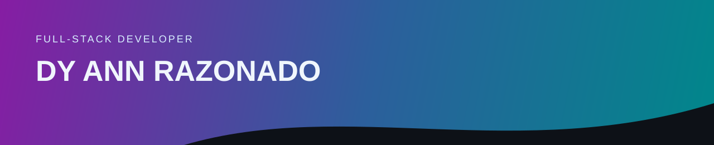

Full-stack developer focused on building clean and functional web applications.  
React.js · Node.js · Express.js · MySQL  

[LinkedIn](https://www.linkedin.com/in/razonado-dy-ann-4a7011352/)

---

## Tech stack

**Frontend**  

**Backend**  

**Database**  

**Tools & Platforms**  

## Selected projects

### 01 — Full-stack Todo List

A task manager built with React.js, Node.js, Express.js, and MySQL.

[View project →](https://github.com/dydydan1/CRUD_REACT)

### 02 — ASG GymHub

Capstone project focused on creating a better gym experience.

[View project →](https://github.com/dydydan1/Gymhub)

### 03 — X-Icon Garage

A web application built for X-Icon Garage.

[View project →](https://github.com/dydydan1/X-Icon_Garage_Landing_Page)

### 04 — RayPark

An Arduino-based parking system designed to help monitor and manage available parking spaces.

[View project →](https://github.com/dydydan1/RayParkPartialPrototype)

## Certifications

- **Java**  
  [View certificate (PDF) →](./certificates/Java Fundamentals.pdf)

- **Full Stack Web Development** — Udemy  
  [View certificate (PDF) →](./certificates/UDEMY_CERTIFICATE.pdf)

